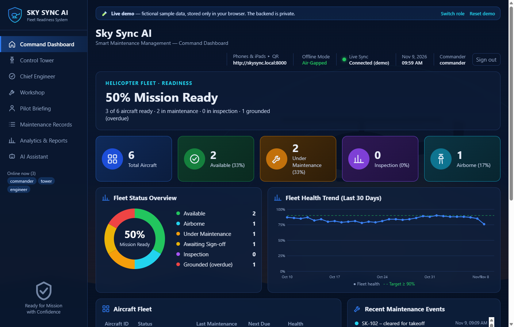
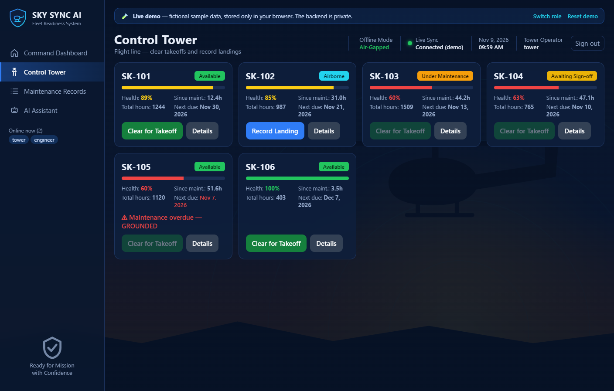
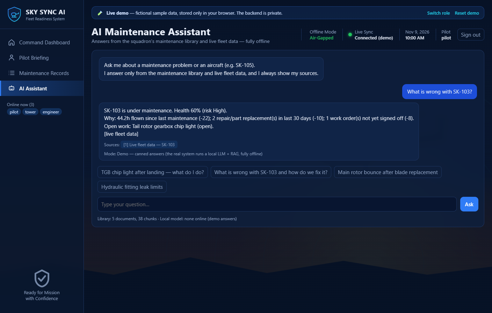
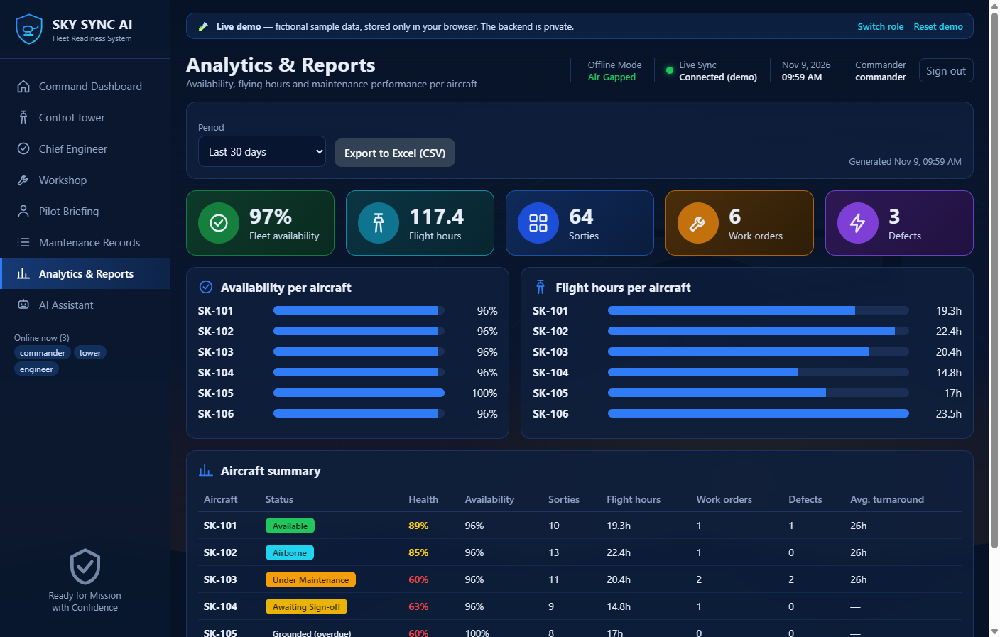
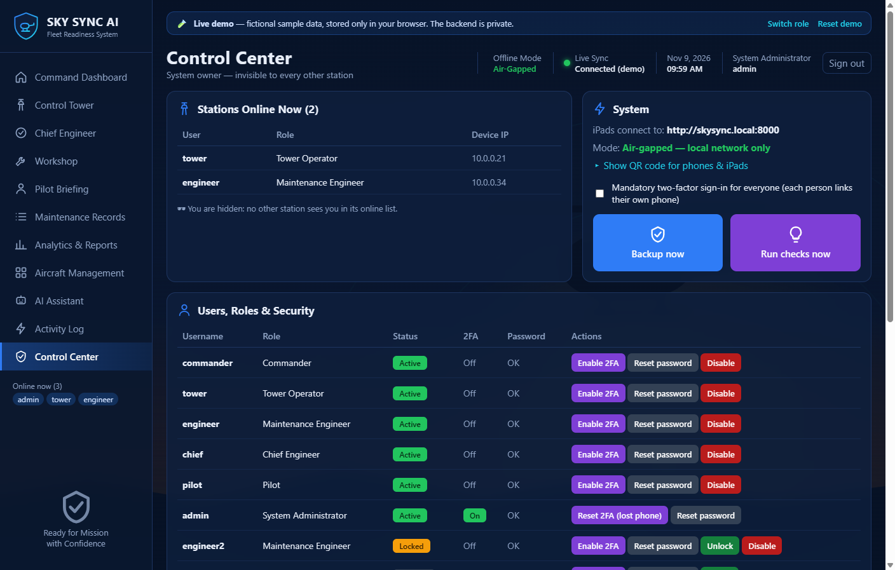

# Sky Sync AI — Fleet Readiness System (Demo)


A real-time maintenance and readiness system for a helicopter fleet. It runs **fully offline** on a local network and gives commanders a live readiness dashboard, while the control tower, engineers and pilots each get their own workflow. An AI maintenance assistant answers questions from the maintenance library and live fleet data.

This repository is a **public demo**: the production screens plus a **Python engine** that reproduces the system's business rules, using fictional data.
The production backend is private and **not** included here.



## ▶️ Run it

**Option 1: Python server (standard library only, nothing to install)**

```bash
git clone https://github.com/salemyousry4-design/skysync-ai-demo.git
cd skysync-ai-demo
python server.py
# open http://localhost:8000
```

Every browser and device on your Wi-Fi shares the same fleet. Try the **Tower** on a phone and the **Commander** on a laptop.

**Option 2: in the browser (GitHub Pages)**

The same Python code runs inside the browser with [Pyodide](https://pyodide.org). No server is needed, and each visitor gets their own copy of the data.

On the sign-in screen, pick a role (or use any demo username with the password `demo`).

## 👥 One system, six roles

| Role | What they do |
|---|---|
| **Commander** | Fleet readiness at a glance: mission-ready %, health trend, predictive alerts |
| **Tower Operator** | Clears takeoffs and records landings. Overdue aircraft are blocked automatically |
| **Maintenance Engineer** | Opens work orders and records the work done |
| **Chief Engineer** | Certifies aircraft airworthy, or sends the work back for rework |
| **Pilot** | Gets a pre-flight briefing and reports defects after landing |
| **System Administrator** | Manages users and roles, 2FA, account lockout, the security log and the append-only activity log |

## 🐍 The Python engine: `skysync_demo/`

| Module | What it does |
|---|---|
| [`rules.py`](skysync_demo/rules.py) | **Explainable health score** (0–100 with reasons), the 50-hour / 30-day overdue rule, status derived from work orders, predictive insight |
| [`api.py`](skysync_demo/api.py) | Every `/api/...` endpoint as a small function registered with `@route`, with role checks on each one |
| [`permissions.py`](skysync_demo/permissions.py) | Role-based access control and the password policy |
| [`reports.py`](skysync_demo/reports.py) | Availability, sorties, flight hours, turnaround time, CSV export |
| [`assistant.py`](skysync_demo/assistant.py) | Answers only from known sources, always cites them and never guesses |
| [`seed.py`](skysync_demo/seed.py) | The fictional starting fleet (reproducible) |
| [`server.py`](server.py) | HTTP server built on `http.server` |

**Tests:** `pytest -q` runs 55 tests covering the rules, permissions and full maintenance cycles (open → complete → certify, reject → rework). They run automatically on every push.

```text
Browser screens (HTML/CSS/JS)
        │  /api/...
        ▼
demo.js ──► python server.py ──► skysync_demo.api   (local)
        └─► Pyodide (Python in the browser) ──► skysync_demo.api   (GitHub Pages)
```

## ✨ Highlights

- **Safety rules enforced by the system**: an overdue aircraft can't be cleared for takeoff, and only a chief engineer can return an aircraft to service.
- **Single source of truth**: aircraft status is never typed in by hand; it's derived from the work orders.
- **Live sync across stations**: production uses WebSocket; the demo uses cross-tab messaging plus a change counter.
- **Audit trail**: every action records who did it and when, and can be exported to CSV.
- **Works on desktop, iPad and phone**: the frontend is plain HTML/CSS/JS with no frameworks or CDNs, because it was designed for networks with no internet access.

| | |
|---|---|
|  |  |
|  |  |

## 🏗️ Production stack (private)

`Python · FastAPI · SQLite · WebSocket · TOTP two-factor auth · RBAC · local LLM (Ollama) + RAG · Docker`

## ⚠️ Notes

- All aircraft, people and records are **fictional**; tail numbers such as `SK-101` are made up.
- This is a showcase, not a certified maintenance tool, and its answers are not technical guidance.

---

© 2026 · All rights reserved.
